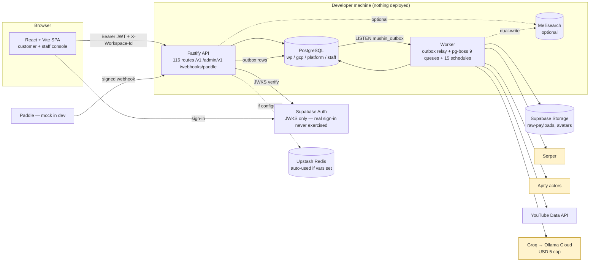
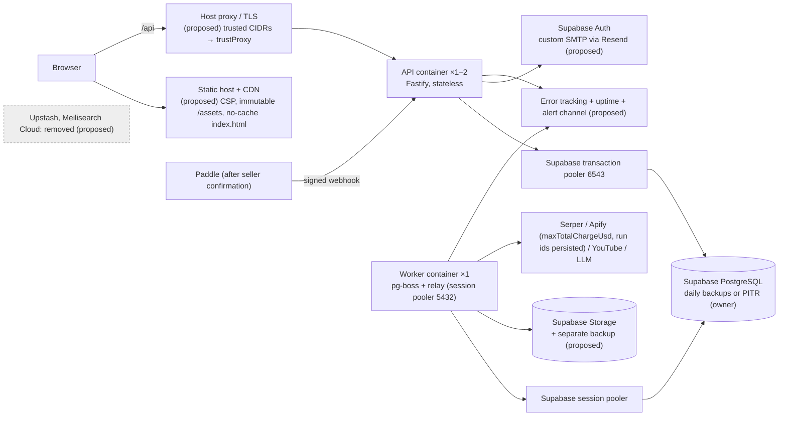
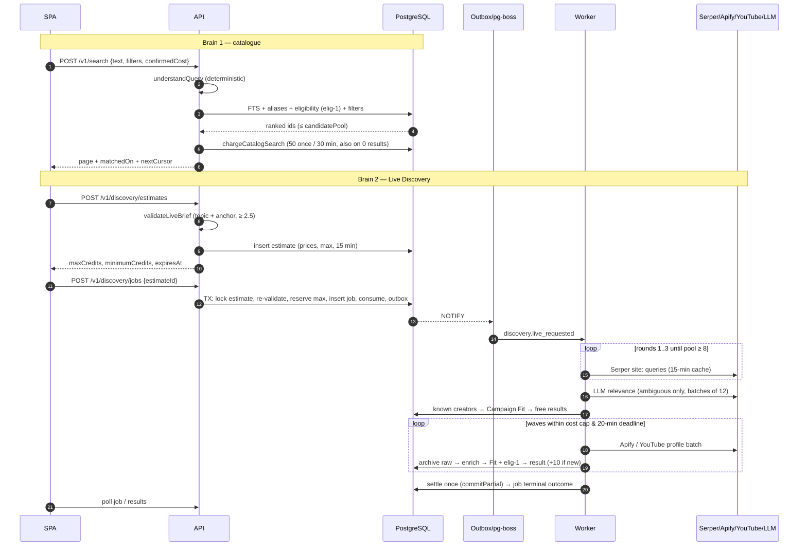
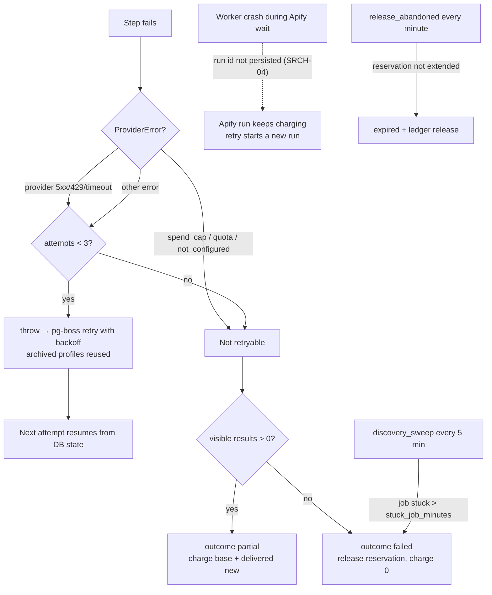
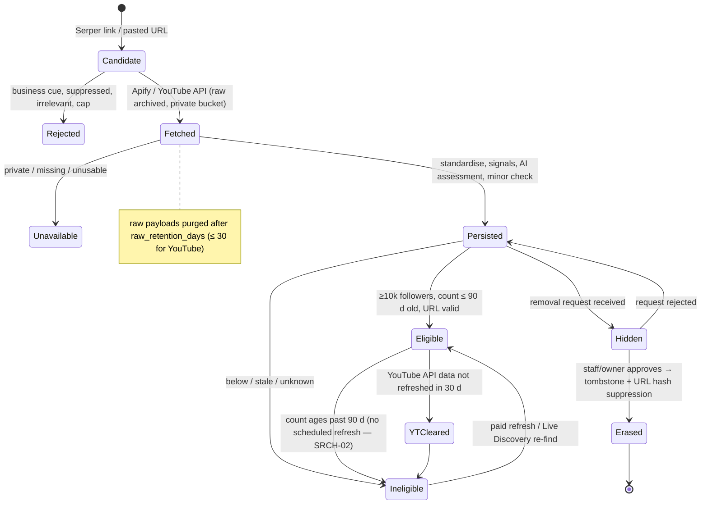
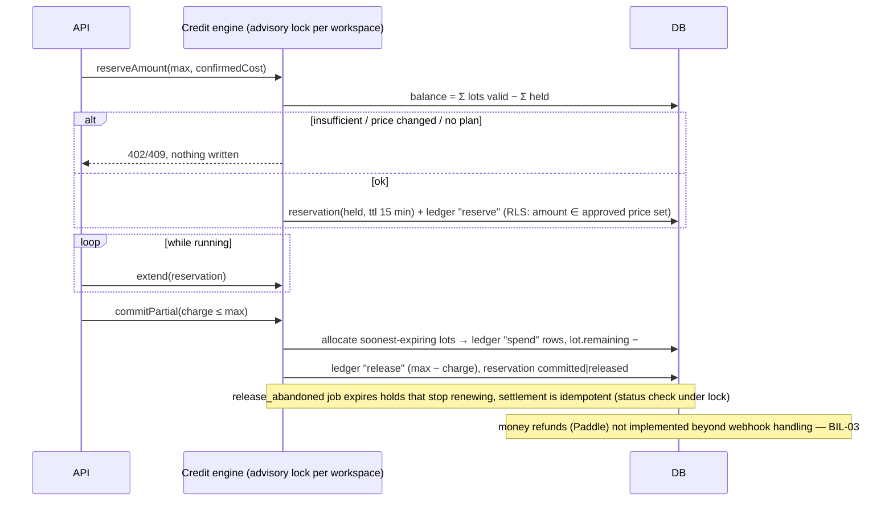
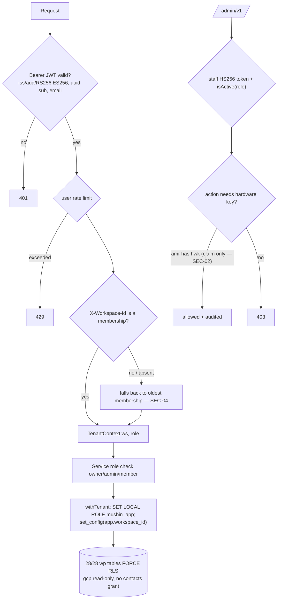
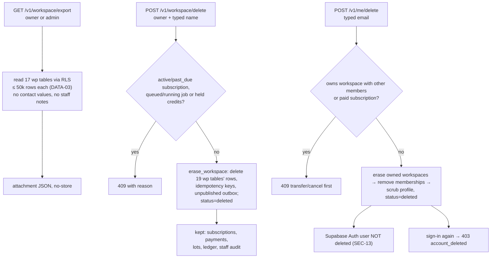
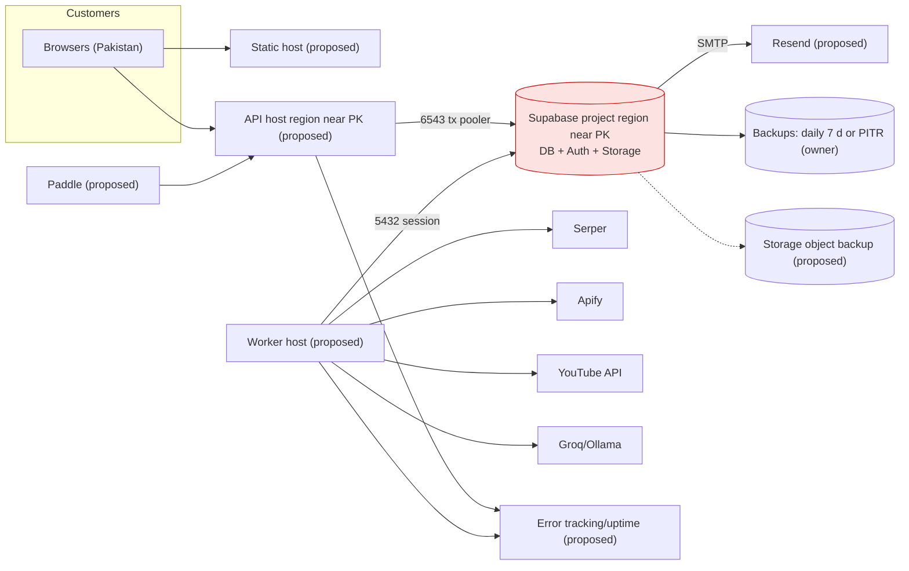

# G — Current and target architecture, data, integration and deployment diagrams

Legend used in every diagram: solid = **verified present** in code at `1398cee`; dashed or labelled **(proposed)** =
not built. No diagram draws a deployed component, because nothing is deployed.

## 1. Layers MUSHIN actually needs

| Layer / cross-cutting concern | Why it exists | Implemented where | State |
|---|---|---|---|
| Presentation (SPA) | Customer + staff UI | `frontend/` React/Vite, hash router | Built; staff UI in same bundle |
| API edge (HTTP, CORS, headers, rate limits, request ids) | One trust boundary for browsers | `apps/api/src/app.ts`, `http/*`, `rate-limit/*` | Built; trustProxy missing (SEC-05) |
| Identity & tenancy | Who is calling, which workspace | `auth/*`, `modules/identity` + RLS | Built; SEC-03, SEC-04 |
| Domain services | Search, discovery, CRM, billing, support, staff ops | `apps/api/src/modules/*` | Built |
| Durable work (outbox → queue → worker) | Long, retryable, paid steps outside requests | `platform.outbox`, pg-boss, `apps/worker` | Built; SRCH-04 |
| Provider adapters (spend-guarded) | Isolate Serper, Apify, YouTube, LLM, Paddle, storage | `packages/integrations` | Built; per-process guards (SRCH-05) |
| Persistence (PostgreSQL, RLS, append-only ledgers) | System of record | `packages/db/migrations` 0001–0037 | Built |
| Object storage | Raw payload archive, avatars | Supabase Storage adapter | Built; not backed up (OPS-04) |
| Search index (optional) | Meilisearch adapter | `integrations/search` | Optional; PostgreSQL default |
| Billing & entitlements | Credits, plans, payments | `modules/billing` | Built (mock payments) |
| Privacy & retention | Erasure, suppression, YouTube expiry, purges | `creators/erasure`, schedules | Built |
| Observability | Logs, metrics, alerts | pino logs + staff alert thresholds | **Partial: no delivery** (OPS-03) |
| Delivery / operations | CI, deploy, backup, DR | `ci.yml` (never run) | **Missing** |

## 2. Current architecture (verified)

## 3. Recommended target architecture (proposed — owner decision D-01)

## 4. Search pipeline sequence (Brain 1 and Brain 2)

## 5. Search failure and retry flow

## 6. Creator data lifecycle (ingestion → enrichment → refresh → deletion)

## 7. ERD — actual database (selected; 37 migrations)

```mermaid
erDiagram
  WP_USERS ||--o{ WP_WORKSPACE_MEMBERS : has
  WP_WORKSPACES ||--o{ WP_WORKSPACE_MEMBERS : has
  WP_WORKSPACES ||--o{ WP_WORKSPACE_INVITATIONS : issues
  WP_WORKSPACES ||--|| WP_SUBSCRIPTIONS : "has (cascade!)"
  WP_WORKSPACES ||--o{ WP_CREDIT_LOTS : "cascade!"
  WP_WORKSPACES ||--o{ WP_CREDIT_RESERVATIONS : holds
  WP_WORKSPACES ||--o{ WP_CREDIT_LEDGER : "append-only (cascade!)"
  WP_CREDIT_LOTS ||--o{ WP_CREDIT_LEDGER : lot_id
  WP_CREDIT_RESERVATIONS ||--o{ WP_CREDIT_LEDGER : reservation_id
  WP_WORKSPACES ||--o{ WP_PAYMENTS : "cascade!"
  WP_WORKSPACES ||--o{ WP_DISCOVERY_ESTIMATES : quotes
  WP_DISCOVERY_ESTIMATES ||--o| WP_DISCOVERY_JOBS : consumed_by
  WP_DISCOVERY_JOBS ||--o{ WP_DISCOVERY_RESULTS : delivers
  WP_DISCOVERY_JOBS ||--o{ WP_DISCOVERY_CANDIDATES : trail
  WP_WORKSPACES ||--o{ WP_LISTS : owns
  WP_LISTS ||--o{ WP_LIST_MEMBERS : contains
  WP_WORKSPACES ||--o{ WP_CAMPAIGNS : owns
  WP_CAMPAIGNS ||--o{ WP_CAMPAIGN_CREATORS : pipeline
  WP_CAMPAIGN_CREATORS ||--o{ WP_OUTREACH_EVENTS : "append-only log"
  WP_WORKSPACES ||--o{ WP_CONTACT_REVEALS : reveals
  WP_WORKSPACES ||--o{ WP_CATALOG_SEARCH_CHARGES : charges
  WP_WORKSPACES ||--o{ WP_SUPPORT_TICKETS : opens
  GCP_CREATORS ||--o{ GCP_CREATOR_PROFILES : "one per platform"
  GCP_CREATORS ||--o{ GCP_CREATOR_CONTACTS : "encrypted, no app grant"
  GCP_CREATOR_PROFILES ||--o{ GCP_ENRICHMENT_SNAPSHOTS : "append-only"
  GCP_CREATORS ||--|| GCP_CREATOR_SEARCH_DOCUMENTS : projection
  GCP_CREATORS ||--o{ WP_DISCOVERY_RESULTS : referenced
  GCP_CREATORS ||--o{ WP_LIST_MEMBERS : referenced
  STAFF_STAFF_USERS ||--o{ STAFF_SESSIONS : refresh_families
  STAFF_STAFF_USERS ||--o{ STAFF_WEBAUTHN_CREDENTIALS : keys
  STAFF_STAFF_USERS ||--o{ STAFF_APPROVALS : requests_decides
  STAFF_STAFF_USERS ||--o{ STAFF_AUDIT_LOG : "insert-only grant"
```

Platform tables not drawn: `platform.outbox`, `provider_calls`, `provider_controls`, `serper_cache`,
`rate_limit_counters` (unlogged), `billing_schedule`, `webhook_events (provider, provider_event_id unique)`,
`idempotency_keys`, plans/packs/costs/settings, `gcp.creator_suppressions`. The pack's `database/*.sql` is a **proposed**
reference and is not drawn here.

## 8. Credit reservation, settlement and refund

## 9. Workspace authorisation and data isolation

## 10. Account deletion and workspace export

## 11. Deployment, queue, database and provider dependencies (target; proposed)

Single points of failure: the Supabase project (DB + Auth + Storage), the single worker (spend guards assume one), and
Serper (only discovery source besides YouTube-native search). External failure of Apify/LLM degrades Live Discovery
gracefully (refund paths verified in tests); a Supabase outage stops everything.
