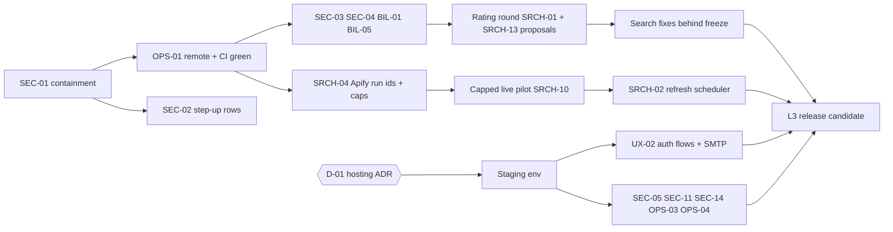

# I — Remediation roadmap, completion levels, readiness checklist and owner decisions

Smallest-safe-change principle: no new service is introduced unless a finding requires it. Search code stays frozen
(`search-freeze-2026-10-16-elig1`) until the rating round is scored; Search-touching fixes (SRCH-06/07/08, SEC-16) are
queued behind it.

## 1. Four completion levels (kept separate)

| Level | Definition | MUSHIN today |
|---|---|---|
| **L1 Feature complete** | Every agreed MVP feature implemented server-side, with UI states and unit/integration tests | **Not met** — missing: catalogue refresh (SRCH-02), legal pages (UX-01), recovery flow (UX-02); Search NOT ACCEPTED |
| **L2 Integration tested** | L1 + reproducible CI green from a clean checkout + reproducible browser E2E | **Not met** — CI never run and would fail (OPS-01); E2E not reproducible (OPS-02) |
| **L3 Release candidate** | L2 + staging with real Supabase Auth, custom SMTP, Paddle sandbox, capped live provider pilot, human-accepted Search, security fixes P0/P1 closed, restore drill | **Not met** |
| **L4 Production deployed & verified** | L3 + production deployed, smoke-tested, monitored with alert delivery, backups verified, legal pages live, owner go/no-go | **Not met** |

## 2. Dependency-ordered plan

## 3. P0 — immediate security, data-loss and correctness (target: before any further sharing or pilot)

| Order | ID | Work (files likely to change) | Migration | Regression tests | Exit criterion | Needs owner? |
|---|---|---|---|---|---|---|
| 1 | SEC-01 | Owner runbook (H §3); `scripts/package-source.sh` (new); CI secret scan | — | Scanner test on a fixture archive | All credentials rotated and logged; packaging refuses ignored files | **Yes** |
| 2 | OPS-01 | `packages/integrations/src/scrapers/scrapers.live.int.test.ts` (read config inside `it`); `.github/workflows/ci.yml` | — | `npm run verify` from a clean clone with no `.env` | CI green on a private hosted remote with SHA recorded | Remote host |
| 3 | SEC-02 | `apps/api/src/modules/staff/{tokens,security-routes,routes,permissions}.ts`; new table `staff.step_ups` | **0038** add `staff.step_ups (id, staff_id, family_id, credential_ref, created_at, expires_at)` | Forged `amr:hwk` → 403; expired step-up → 403; existing webauthn.int | Hardware-key actions require a live step-up row | No |
| 4 | SEC-04 | `apps/api/src/modules/identity/{repository,service}.ts`; `auth/customer-guard.ts`; frontend `api/workspace.ts`, `api/client.ts` | — | Non-member header → 403; response header `x-workspace-id` matches; two-tab E2E | No silent fallback | No |
| 5 | SEC-03 | `auth/customer-token.ts` (use `app_metadata.email_confirmed` set by a Supabase access-token hook, or Auth admin lookup in `team.accept`) | Supabase hook SQL (on the project) | Token with only `user_metadata.email_verified` cannot accept | — | No |
| 6 | BIL-01 | `frontend/src/app/lib/plans.ts`, `landing/Metrics.tsx`, quote dialog `FindNewDialog.tsx`; `plans-claims.test.ts` | — | Copy test pins base/per-creator/minimum constants | Copy equals settlement | **Wording approval** |
| 7 | BIL-05 | migration | **0039** FKs on `wp.credit_ledger/credit_lots/payments/subscriptions` → `on delete restrict`; trigger blocking hard delete of `wp.workspaces` | Hard delete fails; `erase_workspace` passes; erase-coverage guard | — | Retention (OD-013) later |
| 8 | SRCH-04 | `packages/integrations/src/scrapers/{apify,scraper}.ts`; `packages/db` provider run table; `discovery/live-runner.ts` | **0040** `platform.provider_runs (provider, run_id, job_id, batch_key unique, status, started_at, cost_usd)` | Kill worker mid-run (fake Apify): resumes same run; one cost row; `maxTotalChargeUsd` + `runTimeoutSecs` sent | No duplicate paid runs | No |

## 4. P1 — Search acceptance and critical product blockers

| Order | ID | Work | Exit criterion | Owner? |
|---|---|---|---|---|
| 1 | SRCH-13 → SRCH-01 | Approve protocol proposals P1–P10 (F §6); name raters by 20 Oct; run round; add CI/`metrics.ts` reporting (standard P@5, CIs, weighted kappa) — a reporting-only change that does not alter rankings | Signed Pass/Fail/Inconclusive report per brain | **Yes** |
| 2 | DOC-01 | Apply register B decisions; regenerate `traceability.csv` from code + tests; mark pack superseded sections | No open DIS without a decision | Several |
| 3 | ARCH-01 / D-01 | ADR: hosting topology | ADR signed | **Yes** |
| 4 | UX-01 | Legal pages (static routes `#/terms`, `#/privacy`, `#/refunds`, `#/creator-data`), acceptance version stored on `wp.users` (**0041** `terms_version`, `terms_accepted_at`) | Pages live; signup records version | **Yes** (counsel) |
| 5 | UX-02 | Supabase PKCE flow; `#/reset-password` screen; auth event handling; staging tests | All email links work in staging | No |
| 6 | BIL-02 | Zero-result search free (`search-charge.ts` releases on `cards.length === 0`) — if approved | Balance unchanged on empty search | **Yes** |
| 7 | SRCH-07 | `.strict()` on search filter schemas (after freeze) | Unknown key → 400 | No |
| 8 | SRCH-06 | `ignored` clauses in response + UI chip (after freeze) | Behaviour case Q023 passes | No |
| 9 | SRCH-03 | Declare launch scope per platform/script; plan round 2 | Scope statement in pricing/FAQ | **Yes** |
| 10 | OPS-02 | Synthetic fixture catalogue + seed + CI nightly E2E | Fresh clone E2E green | No |
| 11 | SRCH-10 | Capped live pilot (F §8) after SRCH-04 | Pilot report | **Yes (spend)** |
| 12 | SRCH-02 | Refresh scheduler: `platform.refresh_policy`, worker job `creator.refresh_due` with monthly USD cap, priority by saves/searches/last-seen; YouTube API refresh ≤ 25 days | Pinned-clock simulation keeps eligible share ≥ owner target within cap | **Yes (budget)** |
| — | DIS-26 | Restrict purchases to Owner (`billing/service.ts`) or confirm Admin purchasing | Decision recorded | **Yes** |

## 5. P2 — production reliability and operational readiness

Staging environment (per ADR) → SEC-05 trustProxy → SEC-11 Supabase exposure check → SEC-14 headers → OPS-03 error
tracking/uptime/alert channel → OPS-04 backup + restore drill with erasure replay → BIL-03 Paddle sandbox → SEC-06/ARCH-03
remove Upstash → SRCH-05 DB-backed provider budget reservations → BIL-06 one live job per workspace (**0042** partial
unique index) → SEC-07 enrolment approval → SEC-09 key versioning + re-encrypt tool → SEC-13 Auth user deletion →
SEC-10 audit hash chain (**0043**) → SRCH-09 / SEC-16 transparency → OPS-05 load test → ARCH-07 config check → DATA-03
streamed export → BIL-04 constraint.

Each item's acceptance criterion and tests are in `registers/gap_register.csv`. Rollback for every migration above:
forward-only; each is additive (new table/index/constraint added `NOT VALID` then validated) so the previous app version
keeps working; reverting the app does not require reverting the schema.

## 6. P3 — maintainability and enhancements

SRCH-08 keyset pagination · SRCH-12 gazetteer · UX-04 code splitting · UX-05 manual accessibility review · SEC-15 delete
fake testimonials · ARCH-02 env cleanup · ARCH-04 remove Meilisearch Cloud · historical-doc banners (B §4).

## 7. Module-by-module plan with entry/exit gates

| Module | Entry condition | Tasks | Tests | Exit criterion | Rollback |
|---|---|---|---|---|---|
| M0 Repository & secrets | Owner available | SEC-01, OPS-01 | CI | Green CI, rotated keys | n/a |
| M1 Identity & tenancy | M0 | SEC-02, SEC-03, SEC-04, SEC-07, ARCH-07 | int + E2E | All P0 identity tests pass | Revert app commit; tables additive |
| M2 Billing integrity | M0 | BIL-01, BIL-05, BIL-04, DIS-26, BIL-02 (if approved) | engine/service int | Copy = settlement; ledger undeletable | Additive migrations |
| M3 Provider safety | M0 | SRCH-04, SRCH-05, BIL-06 | fake-provider int, kill tests | No orphaned/duplicate runs; caps global | Feature flag `PROVIDER_RUNS_V2` |
| M4 Search acceptance | M1–M3 not required (frozen code); protocol approved | SRCH-13, SRCH-01, SRCH-03 scope | human | Signed report | n/a |
| M5 Search fixes | M4 scored | SRCH-06/07/08/09, SEC-16, SEC-08 | unit/int + re-run freeze/eval diff | Behaviour cases pass; diff vs baseline reviewed | Revert; baseline tag |
| M6 Catalogue lifecycle | M3 + spend approval | SRCH-02, SRCH-10 pilot | pinned-clock int; pilot | Eligible share target met under cap | Disable scheduler flag |
| M7 Auth & legal | Staging + counsel | UX-01, UX-02, SEC-13, custom SMTP | staging E2E | All Supabase links work; legal pages live | — |
| M8 Platform & ops | ADR D-01 | staging, SEC-05/11/14, OPS-03/04/05 | drills | Alerts reach a human; restore drill passes | Host rollback to previous image |
| M9 Payments | Paddle seller confirmed | BIL-03 | sandbox E2E | Subscribe/renew/cancel/refund verified | Keep mock; checkout flag off |
| M10 Release | M1–M9 | Go/no-go checklist §9 | smoke | Owner sign-off | Previous deploy |

## 8. Decisions required from the owner

| ID | Decision | Recommended default | Blocks |
|---|---|---|---|
| D-01 | Target architecture: keep Node API + worker on containers with Supabase DB/Auth/Storage **or** port to Edge Functions/pgmq | Keep Node (D §2) | Staging, all P2 |
| D-02 | Raters A, B and adjudicator (by **2026-10-20**); approve protocol proposals P1–P10 | Approve P1–P5, P8–P10; defer P6–P7 | Search acceptance |
| D-03 | Credential rotation and archive withdrawal (H §3) | Do now | Everything shared |
| D-04 | Public wording of Live Discovery pricing (BIL-01) | Fix copy to match rule | Paid launch |
| D-05 | Charge for zero-result catalogue searches? (BIL-02) | Free | Trial conversion |
| D-06 | Can workspace Admins purchase? (DIS-26) | Owner only | Billing roles |
| D-07 | Staff auth: harden custom (SEC-02/07) for the pilot, or migrate to Supabase Auth before external staff | Harden now, migrate before external staff | Staff access |
| D-08 | Catalogue refresh budget and priority policy (SRCH-02) | e.g. USD 10/month cap, saved-first | Brain 1 viability |
| D-09 | Capped live pilot envelope (F §8) | Approve after SRCH-04 | Brain 2 acceptance |
| D-10 | Launch scope per platform/script (SRCH-03) | Instagram + YouTube; TikTok beta | Claims |
| D-11 | Bio contact policy (SEC-08) | Redact; reveal for bio contacts | Privacy consistency |
| D-12 | RPO/RTO, PITR spend, billing-record retention period (OPS-04, OD-013) | RPO 24 h pilot; 7-year financial retention subject to counsel | DR, deletion copy |
| D-13 | Legal review questions H §5 | Engage counsel | Paid launch |
| D-14 | Paddle seller eligibility (BIL-03) | Confirm in writing | Paid launch |
| D-15 | API path model (DIS-18 / OD-012) | Keep `/v1` + header with SEC-04 fix; update OpenAPI | Contract |
| D-16 | Paid-start limit values (DIS-16) | Keep 20/h user, 100/h workspace | — |
| D-17 | Plan display names and Scale credits (DIS-15) | Starter/Growth/Scale, 35,000 | Pricing page |
| D-18 | Trial abuse beyond one-per-identity; trial after account deletion (SEC-13) | Keep one per identity | — |

## 9. Production-readiness checklist (outcome today)

| # | Gate | Outcome | Evidence |
|---|---|---|---|
| 1 | Clean install + lint + typecheck + boundaries | **PASS** | [ran] |
| 2 | Unit + integration tests from a clean checkout without secrets | **FAIL** (1 suite errors without `.env`; 847 pass) | [ran] OPS-01 |
| 3 | Frontend typecheck, build, bundle secret scan | **PASS** | [ran] |
| 4 | CI running on a hosted remote | **FAIL** | No hosted remote |
| 5 | Migrations from empty DB | **PASS** (PostgreSQL 16) | [ran] |
| 6 | RLS on all workspace tables | **PASS** | [ran] 28/28 |
| 7 | Secrets never distributed | **FAIL** | SEC-01 |
| 8 | Staff privileged actions require proven hardware key | **FAIL** | SEC-02 |
| 9 | Tenant selection cannot silently switch workspace | **FAIL** | SEC-04 |
| 10 | Browser E2E reproducible | **FAIL** | OPS-02 |
| 11 | Search human-rated gates | **BLOCKED** (raters) | SRCH-01 |
| 12 | Live provider pilot | **BLOCKED** (spend authorisation) | SRCH-10 |
| 13 | Real Supabase Auth flows | **BLOCKED** (project/SMTP) | UX-02 |
| 14 | Payments sandbox | **BLOCKED** (Paddle account) | BIL-03 |
| 15 | Public claims match server behaviour | **FAIL** | BIL-01 |
| 16 | Legal pages | **FAIL** | UX-01 |
| 17 | Hosting decided, staging exists | **BLOCKED** (D-01) | ARCH-01 |
| 18 | Error reporting + alert delivery | **FAIL** | OPS-03 |
| 19 | Hosted backup + restore drill | **BLOCKED** (no host) | OPS-04 |
| 20 | Security headers on SPA host | **BLOCKED** (no host) | SEC-14 |
| 21 | Provider spend caps global and fail-closed | **FAIL** (per process; orphan runs) | SRCH-04/05 |
| 22 | Catalogue freshness sustainable | **FAIL** | SRCH-02 |
| 23 | Accessibility: automated axe | **PASS (reported, not re-run)** | [doc] |
| 24 | Accessibility: manual keyboard/screen reader | **FAIL** (not done) | UX-05 |
| 25 | Load test at 2× pilot peak on staging | **BLOCKED** | OPS-05 |
| 26 | Legal review of data sources and YouTube identifiers | **BLOCKED** (counsel) | H §5 |

## 10. Traceability checklist template (Requirement → Implementation → Automated tests → Manual/external → Result)

Use `registers/traceability_checklist.csv` (one row per requirement ID; filled for the items audited here). Rows may only
move to **Passed** with a commit SHA, a CI run URL and, where applicable, the external evidence (rating report, sandbox
receipt, drill log). Checks that need external accounts, human review or authorisation are marked so in the
`verification_type` column: `local`, `ci`, `external-account`, `human-review`, `authorisation`, `legal`.
