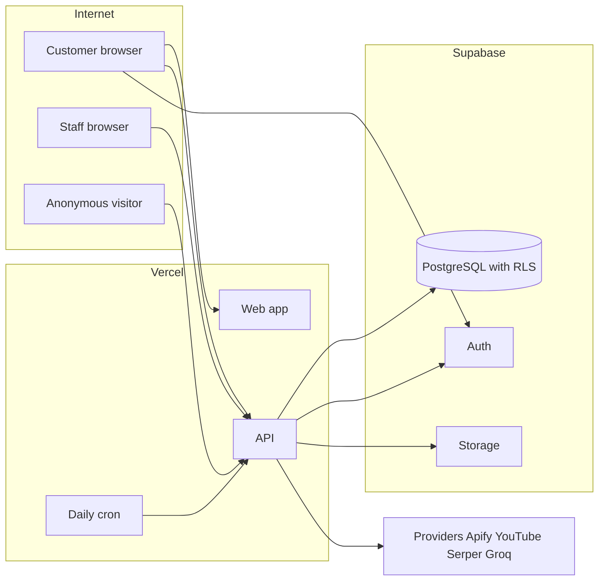

# MUSHIN — threat model (18 Nov 2026)

## Executive summary
MUSHIN is a multi-tenant SaaS (React app + Fastify API on Vercel, PostgreSQL on Supabase, Supabase Auth) that sells
credit-metered access to a catalogue of Pakistani creators. The highest-value targets are tenant data (lists, campaigns,
outreach logs, revealed creator contacts), money-equivalent state (credits, plans) and the staff console. The two worst
issues found in the 17 Nov audit — buying a paid plan through the mock payment pages on the live site, and one rate-limit
bucket shared by every visitor — are fixed and deployed. Remaining risk concentrates on: authentication tokens kept in
browser storage (XSS → account takeover, mitigated by a strict CSP), the staff console (high privilege, partly
mitigated by TOTP, lockout and hardware-key step-up), and prompt injection into the AI assessment (integrity of creator
classifications, not data theft).

## Scope and assumptions
- In scope: `apps/api/src`, `apps/worker/src`, `frontend/src`, `packages/*`, `vercel.json`, `packages/db/migrations`.
- Out of scope: catalogue build scripts run by the operator on a local machine (`scripts/catalog/*`), tests, E2E tooling.
- Assumptions (owner context from the 17 Nov session, not re-confirmed): pilot scale (tens of customer accounts, a few
  staff); customers are brands and agencies in Pakistan; no payment provider (payments closed); no email provider;
  no worker host (daily maintenance runs through Vercel Cron); internet-exposed at `omega-api-kappa.vercel.app`.
- Open questions that would change the ranking: (1) Will Paddle go live soon? (payment webhooks and checkout become
  money paths); (2) Will staff accounts ever exceed the founders? (raises staff-console insider risk); (3) Is creator
  contact data subject to a data-protection regime the company must honour (PDPB / GDPR customers)?

## System model
### Primary components
- Browser app (`frontend/src`), served by Vercel with CSP, HSTS, frame-deny (`vercel.json`).
- API (`apps/api/src/server.ts`): Fastify, helmet + CORS allowlist (`apps/api/src/http/security.ts`), Postgres-backed rate
  limits (`apps/api/src/rate-limit/postgres.ts`), customer JWT verification (`apps/api/src/auth/customer-token.ts`).
- PostgreSQL (Supabase, pooler, TLS verified with the built-in Supabase root CA `packages/core/src/supabase-ca.ts`), with
  row-level security on every `wp` table (`packages/db/migrations/*`).
- Supabase Auth (passwords, email confirmation, TOTP two-step).
- Staff console (`/admin/v1/*`, `apps/api/src/modules/staff`), separate staff JWT + refresh cookie.
- External providers: Apify, YouTube Data API, Serper, Groq LLM, Supabase Storage.

### Data flows and trust boundaries
- Internet → Vercel edge → API: JSON over HTTPS; customer bearer JWT (RS/ES256, issuer and audience checked); zod schema
  on every input (`apps/api/src/http/validate.ts`); per-IP and per-user rate limits in Postgres; client IP from the edge's
  X-Forwarded-For (`packages/core/src/config.ts trustedProxiesFrom`).
- API → PostgreSQL: TLS (verified CA), parameterised SQL (drizzle `sql` templates); tenant context via `withTenant`
  setting `app.workspace_id`, enforced by RLS policies.
- API → Supabase Auth admin: service key; email-confirmation gate and two-step status read from the Auth server's record
  and failing closed (`apps/api/src/auth/auth-admin.ts`).
- Staff browser → `/admin/v1`: staff JWT, TOTP at sign-in, lockout after 5 failures, hardware-key step-up for admin
  actions (`apps/api/src/modules/staff/permissions.ts HARDWARE_KEY_ACTIONS`), deny-by-default permission map, audit log.
- API/scripts → LLM: creator bios and captions inside escaped `<tag>` fences (`apps/api/src/modules/creators/rules.ts
  fenced`), outputs schema-checked; no tool use by the model.
- Vercel Cron → `/v1/internal/cron/daily`: bearer CRON_SECRET compared in constant time; 404 otherwise.

#### Diagram

## Assets and security objectives
| Asset | Why it matters | Objective |
|---|---|---|
| Tenant records (lists, campaigns, outreach, notes) | Customer business data | C, I |
| Revealed creator contacts (encrypted at rest) | Personal data, paid for with credits | C |
| Credits, plans, ledger | Money-equivalent | I |
| Customer sessions / two-step state | Account takeover | C, I |
| Staff accounts and audit log | Full platform control | C, I, A |
| Creator catalogue classifications | Product correctness | I |
| Provider keys, service role key, CRON_SECRET | Spend and full DB/admin access | C |

## Attacker model
### Capabilities
- Anyone on the internet: sign up, call every public and customer API with their own valid token, script requests.
- A malicious customer: craft IDs of other tenants' records, replay requests, race concurrent spends.
- A creator: control their own bio and captions (text fed to the AI and shown to customers).
### Non-capabilities
- No access to Vercel/Supabase consoles, environment variables or the database network.
- Cannot forge Supabase or staff JWTs without the signing keys; cannot reach the local catalogue build machine.

## Entry points and attack surfaces
| Surface | How reached | Trust boundary | Notes | Evidence |
|---|---|---|---|---|
| Customer API `/v1/*` | Bearer JWT | Internet → API | All routes guarded (route-guards test) | `apps/api/src/route-guards.test.ts` |
| Public routes (plans, removal, trial request, unsubscribe) | Anonymous | Internet → API | Rate-limited, small bodies | `route-guards.test.ts PUBLIC` |
| Staff `/admin/v1/*` | Staff JWT + TOTP | Internet → API | Hardware key for admin actions | `modules/staff/permissions.ts` |
| Ticket attachments | Signed upload URL | Internet → Storage | Type from magic bytes, 5 MB, malware scan | `modules/support/attachments.ts` |
| Profile photo | `PUT /v1/me/avatar` | Internet → API | ≤150 KB, magic bytes | `modules/identity/routes.ts imageTypeOf` |
| Daily cron | Vercel Cron | Vercel → API | Constant-time secret | `modules/cron/index.ts` |
| Creator text → AI | Provider scrape | Provider → API → LLM | Fenced, schema-checked | `creators/enrichment/assessment.ts` |

## Top abuse paths
1. Steal a session → read a tenant's lists and revealed contacts: inject script (XSS) → read the Supabase token from
   localStorage → call the API as the victim. Blocked today by React escaping and CSP `script-src 'self'`; residual risk if
   a future change adds raw HTML.
2. Cross-tenant read: change a list/campaign ID in a request → API query under RLS returns nothing (404). Covered by E2E
   isolation checks and `security.int.test.ts`.
3. Free credits: double-click / race paid actions → per-workspace credit lock (`billing/engine.ts lockCredits`), idempotency
   keys. Mock purchase path closed on live (`billing/routes.ts paymentsOpen`).
4. Staff takeover: password spraying on `/admin/v1/auth/login` → 5-attempt lockout, TOTP, auth rate-limit bucket.
5. Skip two-step sign-in: use a password-only (aal1) token → API refuses for accounts with two-step on
   (`identity/service.ts two_step_required`); state mirrored only from the Auth server.
6. Poison classifications: a creator writes instructions in their bio → fenced and escaped; worst case a wrong niche or
   account type, corrected by staff review and reassessment.
7. Exhaust paid providers: a customer triggers many refresh/live jobs → credit cost per job, per-workspace job limits,
   monthly provider caps.

## Threat model table
| Threat ID | Threat source | Prerequisites | Threat action | Impact | Impacted assets | Existing controls (evidence) | Gaps | Recommended mitigations | Detection ideas | Likelihood | Impact severity | Priority |
|---|---|---|---|---|---|---|---|---|---|---|---|---|
| TM-001 | External attacker | An XSS sink appears in the app | Steal the Supabase token from localStorage | Account takeover | Sessions, tenant data | CSP `script-src 'self'`, React escaping, no innerHTML (`vercel.json`) | Tokens in localStorage (Supabase default) | Keep the CSP strict; add a CSP report endpoint; consider shorter token lifetimes | CSP violation reports | low | high | medium |
| TM-002 | Malicious customer | Valid account | Read/modify another tenant's records by ID | Data breach | Tenant records | RLS + workspace filters; isolation tests | None found | Keep the route-guard and isolation tests mandatory | 404 spikes per user | low | high | medium |
| TM-003 | Malicious customer | Valid account | Get paid features without paying | Revenue loss | Credits, plans | Credit lock, idempotency, payments closed on live (`billing/routes.ts`) | Paddle not yet integrated end-to-end on live | Re-run the billing E2E against Paddle sandbox before opening payments | Ledger vs payments reconciliation job | low | high | medium |
| TM-004 | External attacker | Staff email known | Brute-force or phish staff login | Platform takeover | Staff console | TOTP, lockout, hardware-key step-up, audit log | Alerts go to a placeholder webhook | Set a real ALERT_WEBHOOK_URL; review the staff audit log weekly | Failed staff logins alert | low | high | medium |
| TM-005 | Creator | Controls own bio | Prompt-inject the assessment | Wrong classification shown to customers | Catalogue integrity | Fenced, escaped text; schema-checked output | Model can still be swayed | Keep staff review queue; sample-audit AI decisions | Rate of staff overrides | medium | low | low |
| TM-006 | External attacker | Internet access | Flood public/customer endpoints | Degraded service | Availability | Postgres rate limits per real client IP | Every request costs a DB round trip | Add Vercel firewall rules for abusive IPs | 429 rate per IP | medium | medium | medium |
| TM-007 | Insider/staff | Admin role | Browse a customer's activity or data | Privacy breach | Tenant data | Admin-only permission, every view audited (`ops/index.ts`) | No customer-facing notice | Show customers when staff viewed their account (support access log exists) | Audit log review | low | medium | low |

## Criticality calibration
- Critical: any unauthenticated read of tenant data; forging a customer or staff session; executing code on the API.
- High: cross-tenant data access with a valid account; buying plans or credits without paying; staff takeover.
- Medium: XSS that needs a new sink; denial of service of the API; leaking provider spend.
- Low: wrong AI classification; information about which creators exist (public data anyway).

## Focus paths for security review
| Path | Why it matters | Related Threat IDs |
|---|---|---|
| `apps/api/src/auth/*` | Customer token, two-step and email gates | TM-001, TM-002 |
| `apps/api/src/modules/billing/*` | Credits, plans, webhooks | TM-003 |
| `apps/api/src/modules/staff/*`, `modules/ops/*` | Staff privileges and audit | TM-004, TM-007 |
| `packages/db/migrations/*` (RLS policies) | Tenant isolation | TM-002 |
| `apps/api/src/modules/creators/enrichment/*` | AI inputs and outputs | TM-005 |
| `apps/api/src/rate-limit/*`, `packages/core/src/config.ts` | Abuse limits, client IP | TM-006 |
