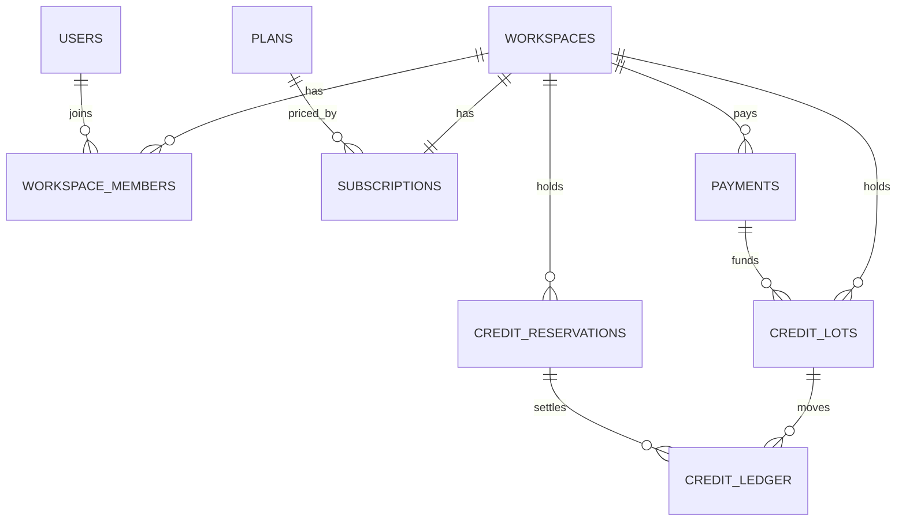
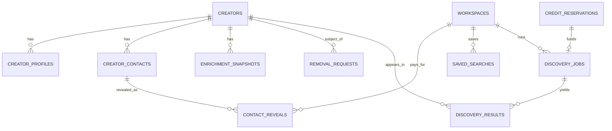
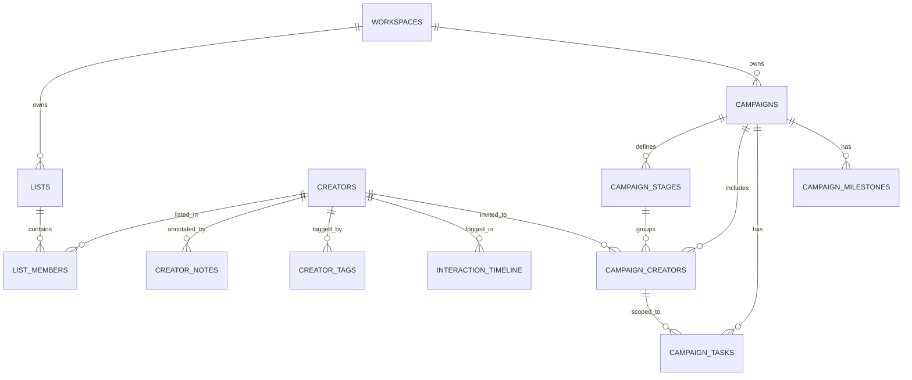
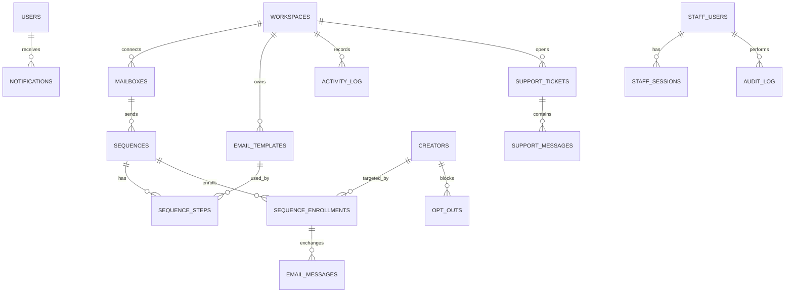

> **Superseded in part (2026-10-21).** The action costs and the trial cap below no longer hold. Current values: `docs/README.md`. Kept unchanged below as history.

# MUSHIN 2.0 Backend: Overall Architecture Design

**Date:** 2026-10-06
**Status:** Draft, awaiting review
**Inputs:** `docs/00-requirements-analysis-and-questions.md` (analysis + answered Q1–Q17), SRS v1.0, System Diagrams PDF, existing `frontend/`.

This is the **umbrella spec**. It fixes the architecture, module boundaries, full data model, cross-cutting conventions and build order for the whole backend. Each of the 9 sub-projects in §3 gets its own short design + spec + implementation plan before it is built, and must stay consistent with this document. If a sub-project needs to deviate, this document is updated first.

---

## 1. Intent

### 1.1 Goal
Replace every mock in the existing Vite + React frontend with a real backend and database, built step by step so each step is tested and working before the next starts.

### 1.2 Success criteria
1. **Golden Path works on real data:** sign up → search → enrich one creator → save to a list, first ranked result in under 5 minutes (reached at the end of sub-project 5).
2. **Every screen the frontend shows is backed by real data** (S1 Must + Should scope). No screen stays half-mocked.
3. **SRS architecture rules are met and demonstrable:** modular monolith + workers, RLS tenant isolation, append-only ledger, outbox, adapters, cost recorded on every external call, separate staff realm.
4. **Runs locally for the FYP demo**, deploy-ready (env-based config, health checks, no hardcoded hosts).

### 1.3 Constraints
- No Docker yet (tests use a second Supabase project until Docker is installed).
- No AWS, no Cloudflare R2, no Paddle keys, no Gmail/Outlook OAuth apps → Postgres queue, Supabase Storage, mock Paddle, mock mailbox, each behind an adapter.
- Frontend changes limited to wiring (API calls, auth client, loading/error states), plus the approved sidebar change and EasyPaisa/JazzCash removal. No redesign.

---

## 2. Decisions

| # | Decision |
|---|---|
| Stack | **TypeScript (strict, no `any`) · Fastify · Drizzle ORM · pg-boss · Zod**, npm-workspaces monorepo |
| Q1 | One personal **workspace** per user, RLS on `workspace_id`, no team UI yet |
| Q2 | Customer auth: **Supabase Auth**, email + password only |
| Q3 | Staff auth: separate realm. `staff` tables, argon2, **mandatory TOTP**, own JWT key, deny-by-default roles `admin`/`support`, full audit log, first admin via CLI script |
| Q4 | Scope: S1 Must + Should, plus real backing for every existing screen. Rating/feedback-link workflow and S2/S3 deferred |
| Q5 | Frontend edited for wiring only. Sidebar becomes exactly: Search, Lists, Campaigns, Inbox, Analytics, Settings. Dashboard via logo; Credits & billing via top-bar menu |
| Q6 | Queue: **pg-boss** (Postgres) behind a queue adapter, swappable to SQS |
| Q7 | Storage: **Supabase Storage** behind a storage adapter, swappable to R2 |
| Q8 | LLM: **Groq** default, **Ollama Cloud** fallback/escalation. **HuggingFace** embeddings → pgvector |
| Q9 | **Mock Paddle** adapter following the real webhook contract until sandbox keys exist. EasyPaisa/JazzCash removed; cards via Paddle only |
| Q10 | Outreach built **last**, against a mock mailbox; real Gmail/Outlook connected when OAuth apps exist |
| Q11 | Instagram `apify/instagram-profile-scraper`; TikTok `clockworks/tiktok-profile-scraper`; YouTube via **official YouTube Data API**, `streamers/youtube-channel-scraper` as fallback. Spend caps: Apify $5/month, Serper 2,500 searches/month (env-configurable) |
| Q12 | Action costs: search existing 0, find new 12, reveal contact 5, refresh 10. Plans: Explorer 2,500 / Growth 12,000 / Scale 35,000 credits/month. Trial 14 days, hard cap 200 credits. Top-ups 1,000 / 5,000 / 15,000, valid 12 months. All stored in DB config |
| Q13 | Pipeline defaults Identified → Contacted → Negotiating → Confirmed, customizable per campaign; Declined is terminal and reachable from any stage; content status tracked separately |
| Q14 | Supabase project is fresh; migrations allowed. Tests use a second Supabase project (`TEST_DATABASE_URL`) until Docker, then local Supabase |
| Q15 | Frontend mock creators are dev/test fixtures only; production starts empty |
| Q16 | Git initialized; commit after each completed build step; no pushing until asked |
| Q17 | Local only for now, deploy-ready. Later target: frontend on Vercel, API + worker on Railway |
| Credits | Unused monthly allowance **does not roll over**; top-ups last 12 months; spending draws from the soonest-expiring lot first |
| DB rollout | Full data model designed here; each sub-project creates its own tables via migrations |

---

## 3. Scope & Build Order

Each sub-project: design → spec → plan → build (plan, implement, test, debug, verify per task) → commit. Each ends with something visible working in the frontend.

| # | Sub-project | Done when |
|---|---|---|
| 1 | **Foundation** | Monorepo, config, `packages/db` + migration runner, DB roles, RLS mechanism, identity tables, customer auth + provisioning, staff realm (login + TOTP + `create-admin`), request ID/logging/errors, rate limiting, idempotency, outbox + pg-boss worker skeleton, adapter base (`instrumented()`), test harness incl. RLS suite, frontend API client + TanStack Query. **Real signup, login, logout in the frontend.** |
| 2 | **Credits & Billing** | Plans/costs/top-up config, subscriptions, credit lots, ledger, reservations, trial, entitlements, mock Paddle checkout + webhooks, payments. Billing screen and credit balance real |
| 3 | **Creator Plane & Search** | `gcp` tables, Meilisearch projection, filtered search < 1 s p95, NL query → editable filter chips, fit ranking, embeddings, AI summaries, saved searches, creator profile with freshness, credit-gated reveal, minor-flag rules |
| 4 | **Live Discovery & Enrichment** | Discovery jobs, Serper/Apify/YouTube adapters, progressive polling, add-by-URL, paid refresh, raw payload archive, spend caps, erasure job |
| 5 | **Lists & CRM** | Lists, bulk add, notes, tags, comments, change history, CSV export, attachments. **Golden Path works end to end** |
| 6 | **Campaigns & Analytics** | Campaigns, stages, creators in pipeline, content status, tasks, milestones, budget/fees, analytics dashboard |
| 7 | **Account surfaces** | Notifications, activity log, support tickets, Settings, sidebar change, EasyPaisa/JazzCash removal |
| 8 | **Admin Console** | Staff views (users, credits, revenue, search ops, providers, security, support, monitoring), audited impersonation, feature flags, cost/error dashboards, DLQ view |
| 9 | **Outreach & Inbox** | Mailboxes, templates, sequences, enrollments, opt-outs, reply handling, Inbox, plan email limits; mock mailbox adapter |

**Deferred (not built):** Collaboration/Rating workflow and creator feedback link, team UI (invites, roles, workspace switcher), all S2/S3 requirements, real Gmail/Outlook/Paddle/SQS/R2 connections (adapters ready), deployment.

---

## 4. Architecture

### 4.1 Repository layout
```
apps/
  api/            Fastify HTTP server (modular monolith)
    src/modules/<module>/{routes,service,repository,index}.ts
  worker/         pg-boss consumers, outbox relay, scheduled jobs
packages/
  contracts/      Zod request/response schemas + inferred types (used by api AND frontend)
  db/             Drizzle schema, SQL migrations, RLS policies, roles, fixtures
  core/           config (Zod-validated env), logger, AppError types, ids, clock, crypto
  integrations/   adapters + mocks: Serper, Apify, YouTube, LLM, Embedder, Payments, Mailer, ObjectStorage
frontend/         existing Vite + React SPA
scripts/          create-admin, seed-dev
docs/
```

### 4.2 Processes
| Process | Entry | DB connection |
|---|---|---|
| API | `apps/api` | `DATABASE_URL` (transaction pooler, `prepare: false`); every transaction starts with `SET LOCAL ROLE mushin_app` |
| Worker | `apps/worker` | `DIRECT_URL` (session pooler; needed for `LISTEN/NOTIFY` and pg-boss); every transaction starts with `SET LOCAL ROLE mushin_worker` |
| Migrations | `npm run db:migrate` | `DIRECT_URL` as migration owner |

Both processes log in with the project's pooler login and **switch role inside each transaction** (verified on Supabase 2026-10-06: role switch, fail-closed RLS and cross-tenant insert rejection all work through the pooler). `packages/db` never exports the raw client: code can only reach the database through `withTenant`, `withSystem` (role `mushin_worker`) or `withOwner` (scripts/migrations only), and dependency-cruiser forbids importing the client module from anywhere else. This avoids extra database passwords while keeping RLS enforced on every query.

### 4.3 Modules
| Module | Owns (tables) | Notes |
|---|---|---|
| `identity` | `wp.users`, `wp.workspaces`, `wp.workspace_members` | provisioning on first request |
| `staff` | `staff.*` | staff auth, permission map, audit writer |
| `billing` | `platform.plans`, `platform.credit_action_costs`, `platform.topup_packs`, `wp.subscriptions`, `wp.credit_lots`, `wp.credit_ledger`, `wp.credit_reservations`, `wp.entitlement_usage`, `wp.payments` | the only writer of credits |
| `creators` | `gcp.*`, `wp.contact_reveals` | reveal, refresh, minor rules, erasure |
| `search` | `wp.saved_searches`, Meilisearch `creators` index | Brain-1, query interpretation |
| `discovery` | `wp.discovery_jobs`, `wp.discovery_results` | Brain-2 orchestration |
| `lists` | `wp.lists`, `wp.list_members`, `wp.creator_notes`, `wp.creator_tags`, `wp.comments`, `wp.interaction_timeline`, `wp.attachments`, `wp.exports` | |
| `campaigns` | `wp.campaigns`, `wp.campaign_stages`, `wp.campaign_creators`, `wp.campaign_tasks`, `wp.campaign_milestones` | analytics = queries |
| `outreach` | `wp.mailboxes`, `wp.email_templates`, `wp.sequences`, `wp.sequence_steps`, `wp.sequence_enrollments`, `wp.email_messages`, `wp.opt_outs` | |
| `account` | `wp.notifications`, `wp.activity_log`, `wp.support_tickets`, `wp.support_messages` | |
| `admin` | `platform.feature_flags` | reads other modules only via their service APIs or `mushin_admin` read models |
| `platform` (shared) | `platform.outbox`, `platform.provider_calls`, `platform.webhook_events`, `platform.idempotency_keys`, `platform.raw_payloads` | infrastructure, no business rules |

### 4.4 Boundary rules
1. A module is used only through its `index.ts` service API. No module imports another's internals or queries another's tables. Enforced by **dependency-cruiser** in `npm run verify`.
2. Synchronous cross-module calls go through service APIs and may share the caller's transaction (e.g. `identity.provision` calls `billing.startTrial` in one transaction).
3. Deferred side effects go through **outbox events**, never direct calls (e.g. `creator.updated` → search reindex).
4. Layers: **routes → service → repository**. Only repositories touch the DB; only services call adapters; routes only parse/validate and call services.

### 4.5 Postgres schemas
| Schema | Contents | Tenant? |
|---|---|---|
| `gcp` | Global Creator Plane | No (shared, no customer data) |
| `wp` | Workspace Plane | Yes: every table has `workspace_id` + RLS |
| `staff` | staff accounts, sessions, audit log | No (staff realm only) |
| `platform` | config, outbox, provider calls, webhooks, idempotency, flags, raw payload index | No |
| `pgboss` | pg-boss internals | No |
| `auth` | Supabase-managed, untouched | — |

---

## 5. Data Model

### 5.1 Conventions
- `uuid` primary keys (`gen_random_uuid()`); `created_at`, `updated_at` (`timestamptz`, UTC).
- Credits: `integer`. Money: `amount_minor bigint` + `currency char(3)`.
- Every `wp.*` table: `workspace_id uuid not null` → `wp.workspaces`, RLS enabled + forced, index leading with `workspace_id`. **Exceptions:** `wp.users` (RLS: `id = app.user_id`) and `wp.workspaces` (RLS: `id = app.workspace_id`); both still have RLS enabled + forced and are covered by the RLS test suite.
- **Append-only tables** (`wp.credit_ledger`, `wp.interaction_timeline`, `wp.activity_log`, `gcp.enrichment_snapshots`, `staff.audit_log`): `UPDATE`/`DELETE` not granted to any app role.
- Cross-plane references (`wp.* → gcp.creators`) are real foreign keys; creators are never hard-deleted (erasure leaves a tombstone), so references stay valid.
- Enumerations: Postgres `text` + `CHECK` constraints (cheaper to evolve than enum types under expand-contract).
- Migrations: expand-contract; no `DROP` of populated columns/tables without a contract phase.

### 5.2 Identity (`wp`)
| Table | Columns |
|---|---|
| `users` | `id` (= `auth.users.id`), `email`, `display_name`, `avatar_url`, `status` (`active`/`suspended`/`deleted`), `preferences jsonb` (notification + AI settings), `deleted_at` |
| `workspaces` | `id`, `name`, `owner_user_id` |
| `workspace_members` | `workspace_id`, `user_id`, `role` (`owner`/`admin`/`member`); unique (`workspace_id`,`user_id`) |

`wp.users` and `wp.workspaces` carry RLS keyed on the current user and workspace (see §5.1 exceptions).

### 5.3 Billing
**Config (`platform`, global, editable without deploy)**
| Table | Columns |
|---|---|
| `plans` | `id` (`explorer`/`growth`/`scale`), `name`, `monthly_price_minor`, `yearly_price_minor`, `currency`, `monthly_credits`, `entitlements jsonb` (`audienceViewsPerMonth`, `outreachEmailsPerMonth`, `campaignLimit`, `export`), `paddle_price_ids jsonb`, `active` |
| `credit_action_costs` | `action` (`search_existing`/`find_new`/`reveal_contact`/`refresh_data`), `credits` |
| `topup_packs` | `id`, `credits`, `price_minor`, `currency`, `validity_months` (12), `paddle_price_id`, `active` |

**State (`wp`)**
| Table | Columns |
|---|---|
| `subscriptions` | `plan_id`, `status` (`trialing`/`active`/`past_due`/`canceled`), `billing_interval`, `paddle_subscription_id`, `current_period_start`, `current_period_end`, `trial_ends_at` |
| `credit_lots` | `source` (`trial`/`monthly`/`topup`/`adjustment`), `amount`, `remaining`, `expires_at`, `payment_id` |
| `credit_ledger` | **append-only**: `amount` (signed), `kind` (`grant`/`spend`/`refund`/`expire`/`adjust`), `action`, `lot_id`, `reservation_id`, `source_ref` (e.g. Paddle transaction id; set on grants, unique per workspace + kind when set), `actor_user_id`, `actor_staff_id`, `note` |
| `credit_reservations` | `amount`, `action`, `status` (`held`/`committed`/`released`/`expired`), `expires_at`, `ref_type`, `ref_id` |
| `entitlement_usage` | `key` (e.g. `audience_views`, `outreach_emails`), `period_start`, `count`; unique (`workspace_id`,`key`,`period_start`) |
| `payments` | `paddle_transaction_id` (unique), `kind` (`subscription`/`topup`), `amount_minor`, `currency`, `status`, `invoice_url` |

**Credit rules**
- **Available balance** = Σ `remaining` of unexpired lots − Σ `held` reservations.
- **Reserve:** in one transaction, lock the workspace's lots (`FOR UPDATE`), check available ≥ amount, insert a `held` reservation (15-min expiry). Insufficient → `INSUFFICIENT_CREDITS`.
- **Commit:** consume lots ordered by `expires_at` ascending; one `spend` ledger row per lot touched; reservation → `committed`. The `held → committed` transition is a guarded update (`WHERE status = 'held'`), so a duplicate commit is a no-op; API-level retries are covered by `Idempotency-Key` (§6.6).
- **Release:** reservation → `released`; no ledger rows.
- **Instant actions** (reveal) reserve + commit in one transaction.
- **Grants** insert a lot + a `grant` ledger row. **Expiry** writes an `expire` ledger row for the remainder and zeroes `remaining`.
- **Invariant (tested):** for every lot, `amount + Σ ledger(lot) = remaining`.
- **Trial:** one 200-credit lot expiring at `trial_ends_at` (14 days). Top-ups are blocked while `trialing`, so the trial can never exceed 200 credits.
- Monthly allowance lots expire at period end (no rollover). Top-up lots expire 12 months after purchase.
- Credits can only be purchased or granted by plan, never earned. Pricing must keep every action ≥ 3× its raw provider cost (checked against `provider_calls` in the admin cost view).

### 5.4 Global Creator Plane (`gcp`)
| Table | Columns |
|---|---|
| `creators` | `display_name`, `primary_handle`, `primary_platform`, `avatar_key`, `city`, `country`, `niches text[]`, `tags text[]`, `verified`, `authenticity_score`, `fake_follower_pct`, `ai_summary`, `ai_summary_model`, `ai_summary_at`, `embedding vector(384)`, `is_minor`, `minor_override_by_staff_id`, `minor_override_reason`, `status` (`active`/`merged`/`removal_requested`/`erased`), `merged_into_id`, `last_enriched_at` |
| `creator_profiles` | `creator_id`, `platform`, `handle`, `canonical_url`, `followers`, `following`, `posts`, `engagement_rate`, `avg_likes`, `avg_comments`, `avg_views`, `bio`, `followers_updated_at`, `engagement_updated_at`, `audience_updated_at`, `last_scraped_at`; **unique (`platform`, `canonical_url`)** |
| `creator_contacts` | `creator_id`, `kind` (`email`/`phone`), `value_encrypted`, `value_hash` (dedupe), `masked`, `trust`, `source`, `first_seen_at`, `last_seen_at`, `last_verified_at` |
| `enrichment_snapshots` | **append-only**: `creator_id`, `verdict`, `evidence_breakdown jsonb`, `audience jsonb` (age/gender/cities with `source` + `confidence`), `model_version`, `confidence` |
| `removal_requests` | `creator_id`, `requester_contact`, `status` (`received`/`verified`/`processed`/`rejected`), `handled_by_staff_id`, `processed_at` |

- Freshness labels (`current`/`aging`/`stale`) are computed from the per-metric `*_updated_at` columns.
- The embedding model (384 dimensions) is selected in sub-project 3's design; changing dimensions later is an expand-contract migration.
- `mushin_app` has `SELECT` only on `gcp`; writes happen in the worker or via the `creators` service using the worker role.

### 5.5 Search & Discovery (`wp`)
| Table | Columns |
|---|---|
| `contact_reveals` | `creator_id`, `contact_id`, `revealed_by`, `ledger_entry_id`; unique (`workspace_id`,`contact_id`). A workspace pays once per contact |
| `saved_searches` | `name`, `query_text`, `filters jsonb` |
| `discovery_jobs` | `kind` (`live`/`add_by_url`/`refresh`), `requested_by`, `query_text`, `interpreted_filters jsonb`, `status` (`queued`/`running`/`completed`/`failed`/`canceled`), `stage`, `reservation_id`, `credits_charged`, `error_code`, `started_at`, `finished_at` |
| `discovery_results` | `job_id`, `creator_id`, `rank`, `fit_score`, `fit_label` (`Best match`/`Strong match`/`Possible match`/`Needs review`), `reason`, `pros jsonb`, `watch_outs jsonb`, `seq` (monotonic per job, for polling cursors) |

`platform.raw_payloads`: `provider`, `request_ref`, `storage_key`, `sha256`, `fetched_at`.

**Meilisearch `creators` index:** derived from `gcp.creators` + `creator_profiles`, updated only via outbox events plus a nightly reconcile. Excludes `is_minor` (without override), `merged`, `removal_requested`, `erased`. Contains no contact values.

### 5.6 Lists & CRM (`wp`)
| Table | Columns |
|---|---|
| `lists` | `name`, `description`, `owner_user_id`, `visibility` (`private`/`workspace`), `favorite`, `tags text[]`, `archived_at` |
| `list_members` | `list_id`, `creator_id`, `added_by`, `added_at`; unique (`list_id`,`creator_id`) |
| `creator_notes` | `creator_id`, `author_user_id`, `body` |
| `creator_tags` | `creator_id`, `tag`; unique (`workspace_id`,`creator_id`,`tag`) |
| `comments` | `target_type` (`list`/`campaign`), `target_id`, `author_user_id`, `body` |
| `interaction_timeline` | **append-only**: `actor_user_id`, `event_type`, `creator_id`, `list_id`, `campaign_id`, `payload jsonb`, `occurred_at` |
| `attachments` | `target_type`, `target_id`, `storage_key`, `filename`, `size_bytes`, `mime`, `uploaded_by` |
| `exports` | `kind` (`csv`), `target_type`, `target_id`, `status`, `storage_key`, `expires_at` (entitlement-gated) |

### 5.7 Campaigns (`wp`)
| Table | Columns |
|---|---|
| `campaigns` | `name`, `status` (`draft`/`active`/`paused`/`completed`), `platform`, `client`, `goal`, `objective`, `brief jsonb`, `budget_minor`, `currency`, `start_date`, `end_date`, `owner_user_id`, `archived_at` |
| `campaign_stages` | `campaign_id`, `key`, `label`, `position`, `is_terminal` |
| `campaign_creators` | `campaign_id`, `creator_id`, `stage_id`, `content_status` (`none`/`content_pending`/`posted`/`completed`/`declined`), `priority` (`low`/`med`/`high`), `fee_minor`, `fee_kind` (`estimated`/`quoted`/`agreed`), `paid_minor`, `due_date`; unique (`campaign_id`,`creator_id`) |
| `campaign_tasks` | `campaign_id`, `campaign_creator_id`, `title`, `assignee_user_id`, `due_date`, `completed_at` |
| `campaign_milestones` | `campaign_id`, `title`, `milestone_date`, `completed_at` |

New campaigns get stages Identified, Contacted, Negotiating, Confirmed, Declined (terminal). Analytics are queries, not tables.

### 5.8 Outreach (`wp`)
| Table | Columns |
|---|---|
| `mailboxes` | `provider` (`gmail`/`outlook`/`mock`), `address`, `oauth_tokens_encrypted`, `status` |
| `email_templates` | `name`, `subject`, `body` (with `{{variables}}`) |
| `sequences` | `name`, `mailbox_id`, `campaign_id` |
| `sequence_steps` | `sequence_id`, `position`, `template_id`, `delay_days` |
| `sequence_enrollments` | `sequence_id`, `creator_id`, `contact_id`, `campaign_creator_id`, `status` (`scheduled`/`active`/`replied`/`opted_out`/`completed`/`failed`), `next_step`, `next_send_at` |
| `email_messages` | `enrollment_id`, `direction` (`out`/`in`), `provider_message_id`, `thread_id`, `subject`, `snippet`, `sent_at`, `received_at` |
| `opt_outs` | `creator_id`, `email_hash`, `reason` |

Enrollment is rejected if the creator or contact matches `opt_outs`, or if the creator is minor-flagged. A reply stops the sequence.

### 5.9 Account surfaces (`wp`)
| Table | Columns |
|---|---|
| `notifications` | `user_id`, `category` (`campaigns`/`credits`/`team`/`system`), `priority` (`info`/`success`/`warning`/`critical`), `title`, `body`, `link`, `read_at` |
| `activity_log` | **append-only**: `user_id`, `type` (`search`/`event`/`credit`/`system`), `title`, `meta jsonb` |
| `support_tickets` | `number` (`T-0001` style, unique), `opened_by`, `subject`, `status` (`open`/`in_progress`/`resolved`), `priority`, `assigned_staff_id` |
| `support_messages` | `ticket_id`, `author_type` (`user`/`staff`), `author_id`, `body` |

### 5.10 Staff (`staff`) and Platform (`platform`)
| Table | Columns |
|---|---|
| `staff.staff_users` | `email`, `name`, `password_hash` (argon2id), `totp_secret_encrypted`, `role` (`admin`/`support`), `status`, `last_login_at` |
| `staff.staff_sessions` | `staff_id`, `refresh_token_hash`, `expires_at`, `ip`, `user_agent`, `revoked_at` |
| `staff.audit_log` | **append-only**: `staff_id`, `action`, `target_type`, `target_id`, `workspace_id`, `metadata jsonb`, `ip`, `request_id` |
| `platform.outbox` | `event_type`, `aggregate_type`, `aggregate_id`, `workspace_id`, `payload jsonb`, `request_id`, `published_at` |
| `platform.provider_calls` | `provider`, `operation`, `model`, `tokens_in`, `tokens_out`, `units`, `cost_usd numeric(12,6)`, `latency_ms`, `status`, `error_code`, `workspace_id`, `job_id`, `request_id` |
| `platform.webhook_events` | `provider`, `event_id`, `event_type`, `payload jsonb`, `received_at`, `processed_at`; unique (`provider`,`event_id`) |
| `platform.idempotency_keys` | `workspace_id`, `key`, `request_hash`, `response_status`, `response_body jsonb`, `expires_at`; unique (`workspace_id`,`key`) |
| `platform.feature_flags` | `key`, `enabled`, `rules jsonb` |

### 5.11 ERD









### 5.12 Safety constraints in the data layer
- **Minor-flagged creators** (`is_minor` without staff override) cannot be revealed, added to `campaign_creators` or enrolled in sequences. Checked in services **and** by `BEFORE INSERT` triggers on `wp.contact_reveals`, `wp.campaign_creators` and `wp.sequence_enrollments`.
- **Erasure:** delete `creator_contacts` and `creator_profiles`, clear personal fields on `creators` (status `erased`), remove from the search index, purge raw payloads for that creator. Workspace references stay valid via the tombstone.
- **Encryption at rest** (AES-256-GCM, `DATA_ENCRYPTION_KEY`): contact values, staff TOTP secrets, mailbox OAuth tokens.

---

## 6. Request Lifecycle, Auth & Tenant Isolation

### 6.1 Route groups
| Prefix | Auth |
|---|---|
| `/v1/*` | customer Supabase JWT |
| `/admin/v1/*` | staff JWT (separate key). Realms never accept each other's tokens |
| `/webhooks/paddle` | Paddle signature (raw body) |
| `/health/live`, `/health/ready` | none |
| `/dev/*` | only when `NODE_ENV=development` (e.g. mock-Paddle "complete payment") |

### 6.2 Pipeline (in order)
1. **Request ID:** accept `X-Request-Id` or generate; echo in response; bind to logger.
2. **Security headers + CORS:** allow `APP_URL` and `ALLOWED_PREVIEW_ORIGINS` only.
3. **Rate limit** (Upstash sliding window): per IP unauthenticated, per user authenticated; stricter buckets for auth and credit-spending routes.
4. **Authenticate:** verify JWT with `jose` against Supabase's cached JWKS. Accept `RS256`/`ES256` only; check `exp`, `iss` = `${SUPABASE_URL}/auth/v1`, `aud` = `authenticated`.
5. **Resolve context** `{ requestId, userId, workspaceId, role }`. If the user has no `wp.users` row, `identity.provision()` creates user + personal workspace + owner membership + trial (`billing.startTrial`) in **one transaction**; idempotent under concurrent first requests (unique constraints + `ON CONFLICT`). Provisioning generates the new workspace id first and runs inside `withTenant` for that id and the user id, so every insert passes RLS like any other request. A user always resolves to exactly one workspace (their membership); the workspace id is never taken from client input.
6. **Validate** params/query/body with Zod contracts; responses are serialized through their response schema.
7. **Handler → service → repository**, then the single error handler (§8).

### 6.3 Tenant isolation (three layers)
1. **Middleware** attaches context; tenant routes cannot run without it.
2. **Repositories** accept only a `TenantTx`, obtainable only from `withTenant(ctx, fn)`. Missing tenant scope is a compile-time error.
3. **RLS:** `withTenant` runs `BEGIN; SELECT set_config('app.workspace_id', $1, true), set_config('app.user_id', $2, true); …; COMMIT`. Policies use `workspace_id = current_setting('app.workspace_id', true)::uuid`. Unset → `NULL` → no rows (fail closed). Transaction-local settings are safe on the transaction pooler.

### 6.4 Database roles
| Role | Used by | Rights |
|---|---|---|
| `mushin_app` | API | DML on `wp` (RLS forced), `SELECT` on `gcp` and `platform` config, insert on `platform.outbox`/`provider_calls`/`idempotency_keys`/`webhook_events`. No DDL, no `BYPASSRLS` |
| `mushin_worker` | worker | as `mushin_app` plus DML on `gcp`, `platform`, `pgboss`. Tenant writes still via `withTenant` |
| `mushin_admin` | `admin` module only (created in sub-project 8) | `BYPASSRLS`, read across tenants; writes only through audited service functions |

`staff.*` tables have no tenant and are reached by the `staff` module with `withSystem` transactions (`SET LOCAL ROLE mushin_worker`); `mushin_app` has no grants on `staff`.
| owner | migrations | DDL |

Supabase's `anon` and `authenticated` roles get **no grants** on `gcp`, `wp`, `staff`, `platform`, and these schemas are not exposed through the Supabase Data API. The frontend uses supabase-js **only for auth**.

### 6.5 Staff realm
- `POST /admin/v1/auth/login` (email + password) → `POST /admin/v1/auth/totp` → 15-min access JWT (HS256, `STAFF_JWT_SECRET`) + refresh token in an httpOnly, `Secure`, `SameSite=Strict` cookie scoped to `/admin/v1/auth`. Refresh tokens rotate; reuse revokes the session.
- Login lockout after repeated failures; all logins audit-logged.
- **Permission map:** `action → allowed roles`; anything unlisted is denied. `support`: tickets + read-only user/workspace views. `admin`: everything.
- **Impersonation:** admin-only, read-only by default, time-limited (30 min), token carries `impersonated_by`; every request under it writes `audit_log`.
- `npm run create-admin` creates the first admin (prompts for email/password, prints TOTP QR code).

### 6.6 Idempotency & webhooks
- Credit-spending and payment-starting POSTs **require** `Idempotency-Key`. Same key + same body → stored response replayed; same key + different body → `IDEMPOTENCY_KEY_REUSED`. Keys expire after `IDEMPOTENCY_TTL_HOURS`.
- `/webhooks/paddle`: verify signature on the raw body → insert `webhook_events` (duplicate → `200`, no-op) → outbox event → `200` immediately. The `billing` queue processes it in order per subscription. Paddle is the source of truth for entitlements.

---

## 7. Async Processing & Adapters

### 7.1 Outbox
- Services insert `platform.outbox` rows in the **same transaction** as the state change.
- The worker relay is woken by `LISTEN/NOTIFY` (1-s poll fallback), publishes each row to its pg-boss queue (job id = outbox id, so duplicates collapse), and sets `published_at`.
- At-least-once delivery; every handler is idempotent. The API never writes to pg-boss directly, so moving to SQS changes only the queue adapter.
- `request_id` travels from HTTP request → outbox row → job payload → worker logs.

### 7.2 Queues
| Queue | Work | Concurrency |
|---|---|---|
| `discovery-high` | live discovery, add-by-URL | 3 (Apify cap) |
| `discovery-standard` | paid refresh | 2 |
| `rescore-low` | embeddings, AI summaries, Meilisearch upserts | 5 |
| `billing` | Paddle webhook events | 1 (ordered per subscription) |
| `outreach` | send steps, sync replies | 2 |
| `erasure` | creator removal | 1 |
| `notify` | notifications, activity rows | 5 |

Retries use exponential backoff (default 5 attempts), then a dead-letter queue visible in the admin console. A job that ends in failure **always releases its credit reservation**.

### 7.3 Scheduled jobs (pg-boss cron)
| Job | Schedule |
|---|---|
| Release reservations held > 15 min | every minute |
| Expire credit lots | hourly |
| Monthly credit grant (mock mode; real mode grants on Paddle renewal webhook) | daily, per period boundary |
| Outreach send tick | every minute |
| Meilisearch reconcile | nightly |
| Purge expired idempotency keys and exports | daily |

### 7.4 Live discovery flow
1. User query → `POST /v1/search/interpret` → LLM returns structured filters, shown as **editable chips** (AI output is a suggestion only).
2. Brain-1 search over Meilisearch (free). If the user chooses "find new creators" and **explicitly confirms the 12-credit cost**:
3. `POST /v1/discovery` (with `Idempotency-Key`), in one transaction: reserve credits, insert `discovery_jobs` (`queued`), insert outbox row → `202 { jobId, pollUrl }`.
4. Worker: `running` → Serper queries → normalize + dedupe URLs → LLM relevance filter → per candidate: **merge** with a known `creator_profiles.canonical_url` or **extract** (Apify / YouTube API) → archive raw payload → **validate and sanitize** (Zod parse, strip HTML/control chars, length caps; scraped data is hostile input) → LLM fit ranking → upsert `gcp` + append `discovery_results` (incrementing `seq`) → outbox `creator.updated` for reindex/embedding.
5. Client polls `GET /v1/discovery/jobs/:id?after=<seq>` every 2 s for new results and status.
6. On completion: **≥ 1 result → commit** reservation; **0 results or failure → release**.

### 7.5 Adapters (`packages/integrations`)
| Interface | Now | Later |
|---|---|---|
| `WebSearch` | Serper | — |
| `ProfileScraper` | Apify (Instagram, TikTok), YouTube Data API (+ Apify fallback) | — |
| `Llm` | Groq → fallback Ollama Cloud | — |
| `Embedder` | HuggingFace Inference | — |
| `Payments` | **Mock** (emits correctly signed fake webhooks) | Paddle sandbox/live |
| `Mailer` | **Mock** | Gmail, Microsoft Graph |
| `ObjectStorage` | Supabase Storage | Cloudflare R2 |
| `Queue` | pg-boss | AWS SQS FIFO |

- Every adapter is wrapped by `instrumented()`: timeout, retry policy, structured log, and a `platform.provider_calls` row with cost. This is the single implementation of "cost recorded on every external call".
- `Llm` calls always pass a Zod output schema; invalid output gets one corrective retry, then the call fails.
- **Spend caps** (`APIFY_MONTHLY_BUDGET_USD`, `SERPER_MONTHLY_SEARCH_LIMIT`) are checked from `provider_calls` before each call; exceeding → `PROVIDER_UNAVAILABLE`, job fails cleanly, reservation released, admin alert.
- Real vs mock is chosen at boot from config; mock mode is logged at startup.

---

## 8. Errors, API Conventions, Config & Observability

### 8.1 Error envelope
```json
{ "error": { "code": "INSUFFICIENT_CREDITS", "message": "…", "details": {}, "requestId": "…" } }
```
| Code | HTTP |
|---|---|
| `VALIDATION_FAILED` | 400 |
| `UNAUTHENTICATED` | 401 |
| `INSUFFICIENT_CREDITS` | 402 |
| `FORBIDDEN`, `ENTITLEMENT_REQUIRED` | 403 |
| `NOT_FOUND` (also for other workspaces' records) | 404 |
| `CONFLICT` | 409 |
| `IDEMPOTENCY_KEY_REUSED` | 422 |
| `RATE_LIMITED` (+ `Retry-After`) | 429 |
| `INTERNAL` (no internals exposed) | 500 |
| `PROVIDER_UNAVAILABLE` | 503 |

Services throw typed `AppError`s; one Fastify error handler maps them. Unknown errors → `INTERNAL`, logged with stack.

### 8.2 API conventions
- REST under `/v1`, JSON, camelCase.
- Cursor pagination: `{ items, nextCursor }`.
- Timestamps ISO-8601 UTC; money `{ amountMinor, currency }`; credits integers.
- `PATCH` is partial. Lists and campaigns are archived, not hard-deleted.

### 8.3 Config
`packages/core/config` parses `.env` with Zod at boot and exits with a list of missing/invalid values. Optional integrations without credentials run their mock and log a warning.

### 8.4 Observability
- pino JSON logs with `requestId`; redaction of `authorization`, cookies, tokens, passwords, contact values, email local parts.
- `/health/live` (process) and `/health/ready` (DB, Meilisearch, Redis).
- Cost, latency and error rates from `platform.provider_calls` (admin dashboard).
- Sentry enabled automatically when `SENTRY_DSN` is set.

---

## 9. Testing, Frontend Integration & Dev Workflow

### 9.1 Testing (Vitest)
| Layer | Scope | Method |
|---|---|---|
| Unit | credit-lot ordering, pricing, permission map, URL normalization, sanitizers, LLM output parsing | fakes, no DB |
| Integration | every route via `fastify.inject` | real Postgres (`TEST_DATABASE_URL`), migrated once per run, tables truncated between files, files run serially; local Supabase after Docker |
| RLS suite | every `wp` table: cross-workspace read/write denied; no context → zero rows | generated from `pg_catalog`; **a `wp` table without RLS + policy fails the build** |
| Append-only | `UPDATE`/`DELETE` rejected on append-only tables | as `mushin_app` |
| Auth | expired, wrong issuer, wrong audience, wrong realm, tampered tokens rejected | locally signed tokens + injected JWKS |
| Credits | ledger/lot invariant, concurrency (parallel reserves never overspend) | integration |
| Workers | each handler; full discovery run | fixture adapters replaying recorded real responses |
| Live smoke | a few real Groq/Serper/Apify calls | `npm run test:live`, opt-in only |

**Definition of done for every build step:** `npm run verify` (ESLint, `tsc` strict, dependency-cruiser boundaries, all tests) passes, then commit.

### 9.2 Frontend integration
- API client in `frontend/src/app/api/`: attaches the Supabase access token, parses the error envelope into typed errors, adds `Idempotency-Key` on spending calls, types from `packages/contracts`.
- **TanStack Query** for fetching, caching, loading/error states and discovery polling.
- Supabase JS client for signup, login, logout, password reset, session refresh.
- Mock stores are deleted as each sub-project replaces them.
- Dev: Vite proxies `/api` → `http://localhost:4000`. Hash routing unchanged.

### 9.3 Commands
| Command | Does |
|---|---|
| `npm run dev` | API + worker + frontend |
| `npm run db:migrate` | apply migrations (`DIRECT_URL`) |
| `npm run db:seed` | load dev fixtures (frontend mock creators) |
| `npm run create-admin` | first staff admin + TOTP QR |
| `npm run verify` | lint + typecheck + boundaries + tests |
| `npm run test:live` | opt-in real-provider smoke tests |

---

## 10. Environment Changes

**User actions (not blocking design or planning; needed before sub-project 1's DB tasks run):**
1. Supabase dashboard → **Connect**: transaction pooler URL (port 6543) → `DATABASE_URL`; session pooler URL (port 5432) → `DIRECT_URL`.
2. Create a second free Supabase project; its session pooler URL → `TEST_DATABASE_URL`.
3. Supabase dashboard → **Settings → JWT Keys**: make sure the project signs with **asymmetric keys** (RS256/ES256). Legacy HS256-only projects publish no JWKS.
4. Install Docker Desktop (later; switches tests to local Supabase).

**Changes made during sub-project 1** (and mirrored in `.env.example`):
| Variable | Change |
|---|---|
| `JWT_ISSUER` | `${SUPABASE_URL}/auth/v1` |
| `JWKS_URI` | `${SUPABASE_URL}/auth/v1/.well-known/jwks.json` |
| `JWT_AUDIENCE` | `authenticated` |
| `DATA_ENCRYPTION_KEY` | new, 32 random bytes (base64) |
| `STAFF_JWT_SECRET` | new, 32+ random bytes |
| `APIFY_MONTHLY_BUDGET_USD` / `SERPER_MONTHLY_SEARCH_LIMIT` | new, `5` / `2500` |
| `APIFY_*_ACTOR_ID` | filled with the Q11 actors (sub-project 4) |
| `SQS_*`, `AWS_*` | left empty (unused while the queue adapter is pg-boss) |

---

## 11. Assumptions & Items Resolved Later

| Item | Resolved in |
|---|---|
| Embedding model (384-dim, multilingual-capable for Roman Urdu) | Sub-project 3 design |
| Plan currency: plans are priced in PKR; Paddle's supported currencies must be confirmed, otherwise prices are shown in PKR and charged in USD | Sub-project 2 design |
| Top-up pack prices (placeholders scaled from plan prices) | Sub-project 2 design; editable in `platform.topup_packs` |
| Exact Meilisearch ranking rules and fit-score formula | Sub-project 3 design |
| Outreach send windows and daily per-mailbox limits | Sub-project 9 design |
